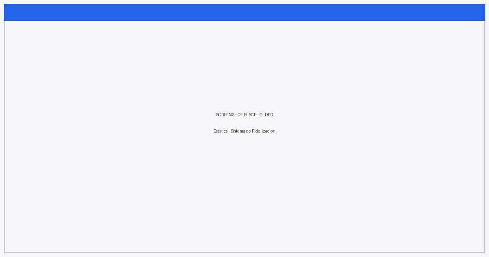

# Estética — Sistema de Fidelización

> Webapp para centros de estética: agenda de turnos, fidelidad por puntos e historial de clientas. MVP pensado para uso real en mostrador: rápido, simple, sin curva de aprendizaje.


## ✨ Funcionalidades

- 📅 **Agenda de turnos** — gestión de visitas del día a día.
- ⭐ **Fidelidad por puntos** — ledger append-only: cada visita suma puntos, canje de premios, deshacer con reversas compensatorias.
- 🗂️ **Historial de clientas** — registro completo de visitas y servicios.
- 📱 **Mobile-first** — diseñada para que la operadora la use desde el celular, con la clienta enfrente, en segundos.

## 🛠️ Stack

- **Next.js 14** (App Router) + **React 18**
- **TypeScript** estricto
- **Supabase** (Postgres, RLS)
- **Vitest** — dominio puro + tests de integración SQL

## 🏗️ Arquitectura

Hexagonal con núcleo chico: solo el ledger de puntos y sus invariantes viven en el hexágono (`src/domain/`, cero imports de Supabase/Next). El resto es CRUD pragmático. Detalles en [AGENTS.md](AGENTS.md).

## 🚀 Desarrollo

```bash
npm install
npm run dev        # Next.js dev server
npm run typecheck  # tsc --noEmit
npm run test       # vitest run
```

## 📸 Screenshot



## 👤 Autor

**Ivan Paolillo — NRD** · 🇦🇷 Argentina
🌐 [nrd.com.ar](https://nrd.com.ar) · 📧 [Contacto](https://nrd.com.ar/contacto)
